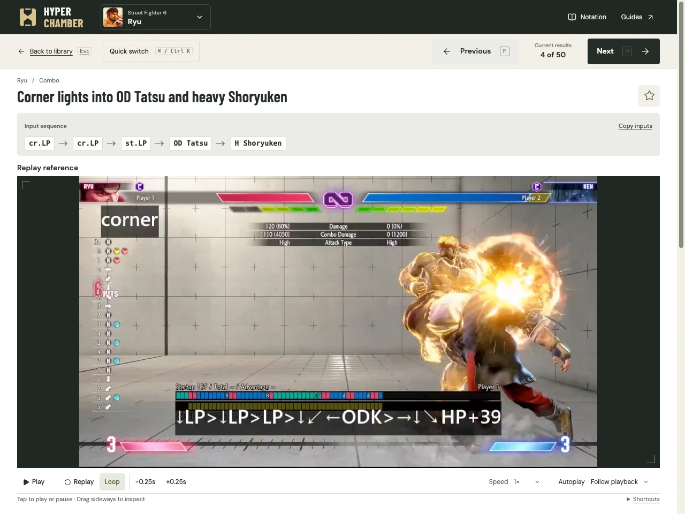
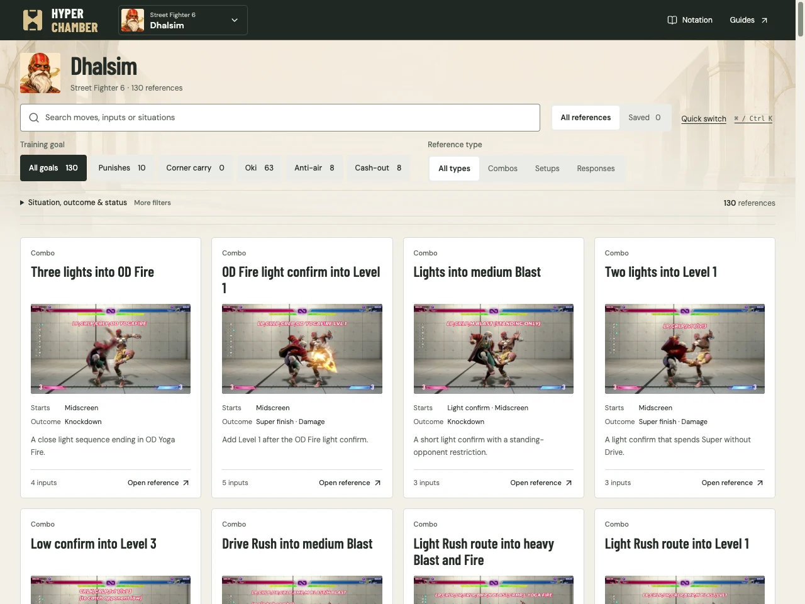
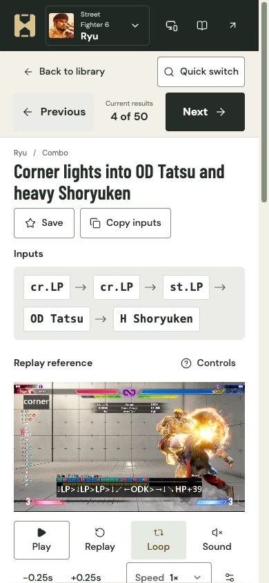

# Hyper Chamber

Hyper Chamber is a fighting-game reference from Squid Quarters, built to keep open beside training mode. Each reference brings together an input sequence, a short replay and execution notes, so you can revisit a combo or setup without finding the same moment in a long tutorial.

It started with Dhalsim and now has over 2,000 references across 32 Street Fighter 6 character libraries. The focus is on the things you want to look up while practising; longer guides and lessons stay with the source creators and [SF6 Lab](https://sf6-lab.net/en/).



Loop a demonstration, slow it down or drag anywhere on the video to inspect a transition. Inputs stay above the replay, with selected key moments, execution notes and source details further down. Previous and Next follow your filtered results, and Quick switch lets you find another reference without returning to the library.



You can browse by character and narrow the list to punishes, corner carry, oki, anti-air or cash-out routes. Save the references you want to return to, then keep your own notes and practice status alongside them. The practice view also adapts to phones and tablets.

<details>
<summary>See the phone view</summary>

<p></p>

</details>

## Run locally

Use Node 24 and pnpm 10.16.1. Prepared clips are included in the repository, so allow several gigabytes for the checkout.

```sh
git clone https://github.com/squid-quarters/hyper-chamber.git
cd hyper-chamber
pnpm install --frozen-lockfile
pnpm dev --host 127.0.0.1 --port 5376
```

Open http://127.0.0.1:5376. No account is needed. Saved references, notes and practice status stay in this browser; clearing site storage removes them. They are not shared between devices yet. Source and guide links need internet access.

For a production build, run `pnpm build`, then `pnpm start`. See the [usage notes](docs/usage.md) for playback settings, keyboard shortcuts and storage details.

## About the references

Each reference credits its creator and links to the original video and timestamp. “Source reviewed” means the annotations were checked against that recording, not re-tested in the game on the current patch. The [coverage index](docs/roster-source-coverage.md) records the selections and gaps for each character.

No open-source license has been chosen yet. Third-party media permissions and redistribution rights remain unassessed; attribution and source records must accompany the media. The [publication record](content/publication.json) describes the repository's current public scope. [Screenshot sources](docs/screenshots/README.md) are recorded separately.

## Development

The app uses SvelteKit in `apps/web`, shared catalog code in `packages/reference`, curated content in `content/games`, and media preparation tools in `tools/ingest`. Learner notes and progress stay separate from the shared references.

```sh
pnpm verify
```

This runs formatting, lint, type checks, unit tests, the static build and catalog/media validation. Changes go through pull requests into `develop`; CI does not deploy the app.

The app version lives in `apps/web/package.json` and appears in the footer, linked to [CHANGELOG.md](CHANGELOG.md). Update both for user-facing app changes. This project does not use Changesets.

The [product scope](docs/product.md), [content model](docs/content-model.md) and [design notes](docs/design.md) cover the longer-term decisions.
